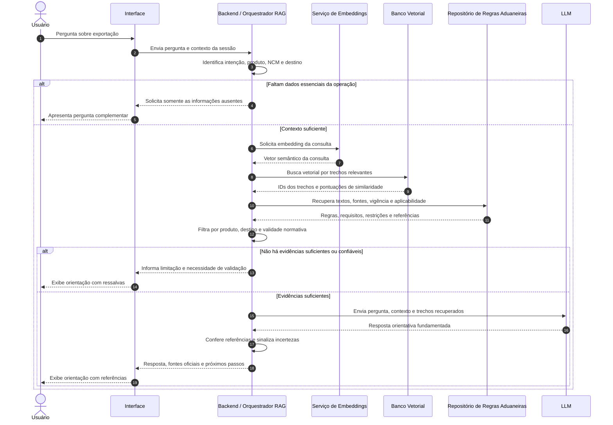

# Assistente de IA para Exportação — Fiep (Grupo 8)

## Diagrama de Sequência — Pipeline RAG

**Escopo:** fluxo de consulta RAG, incluindo busca vetorial, recuperação de regras aduaneiras e chamada à LLM. O diagrama é uma proposta lógica baseada na Visão de Domínio e nos Requisitos Funcionais do projeto; a divisão em serviços não implica tecnologias já definidas.
